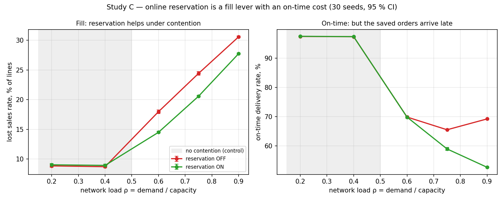
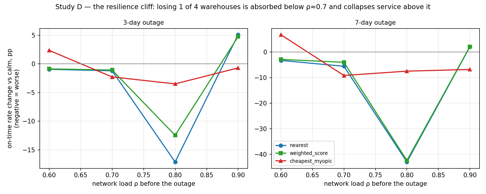
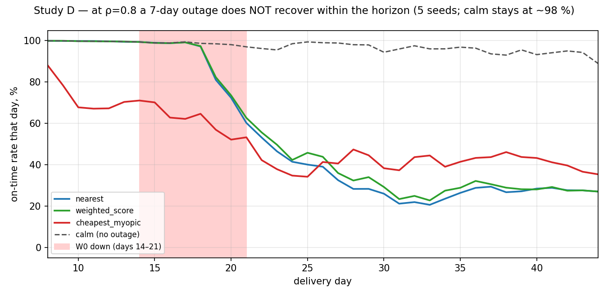

# Two more questions about a warehouse network: reservation and losing a warehouse

*A reproducible experiment on the osbench simulator. 1,380 runs, 30 seeds per cell, paired
comparisons under common random numbers with a Holm correction. A sequel to the
[first study](study_en.md) (sourcing and the promise).*

---

## Why this exists

The next two questions from the `questions_en.md` catalogue, both about investment — in IT
and in resilience:

- **A1.** "If the OMS reserves stock at checkout instead of at pick, how many cancellations
  do we avoid, and what does it cost us?"
- **D3.** "How robust is the sourcing policy to losing a warehouse, and will a smarter
  algorithm save us when a warehouse goes down?"

The protocol is the one from the first study: common random numbers (one seed, one world
for every variant), paired differences by seed, 95 % t and bootstrap CIs, a Holm
correction within each family of comparisons. 45-day horizon, 7-day warm-up, 30 seeds.

The main methodological lesson of both studies recurs here: **choosing the right primary
metric matters more than the statistics.** In both studies the obvious metric
(`total_cost_per_order`) is misleading, and the text says so outright.

---

# Study C. Does online inventory reservation earn its keep?

## The question and the mechanism

Reservation only matters where several orders compete for the same scarce units in the
window between the **sourcing decision** (ATP is read) and the **pick** (book stock is
actually decremented).

- **Reservation off:** every order in that window sees the same book stock as available.
  More units are promised than physically exist; the conflict surfaces at pick as a
  cancelled line (the `penalty_pick` penalty — the most expensive one).
- **Reservation on:** the first orders reserve the stock, later orders' ATP already sees
  zero, and they route elsewhere or fail earlier and more cheaply.

Contention is engineered in `exp_a1_reservation`: a concentrated catalogue (40 SKUs, heavy
Zipf head), demand skewed East onto the capacity-tight warehouse. The sourcing policy is
fixed (`weighted_score`).

## Experiment design

The contention knob is network load ρ = (orders/day × lines) / capacity, via
`demand.base_orders_per_day`. The treatment is `reservation.enabled`.

| | |
|---|---|
| Load ρ | 0.2 / 0.4 / 0.6 / 0.75 / 0.9 |
| Reservation | off / on |
| Seeds | 30 |
| Runs | 300 |
| Primary metric | `lost_sales_rate` |

The ρ ≤ 0.4 cells are the **control arm**: with no contention, reservation should do
nothing.

## Why not total_cost_per_order

In this scenario, total cost per order is ~85 % the purchase cost of goods sold.
Reservation fulfils *more* demand, so it mechanically *raises* cost per order while doing
its job: 47.9 → 53.6 at ρ = 0.9. That is not the price of reservation, it is the cost of
goods that are now actually sold. The primary metric is lost sales; cost per order is not
used in any conclusion (the same denominator trap as Study B in the first paper).

## Results



Reservation on minus off, paired differences, Holm-adjusted:

| ρ | Lost sales, difference | Rel., % | On-time rate, difference | Pick cancellations (off → on) |
|---|---|---|---|---|
| 0.20 | +0.0018 | +2.0 | +0.0005 n.s. | 0.0009 → 0 |
| 0.40 | +0.0022 | +2.5 | +0.0003 n.s. | 0.0012 → 0 |
| **0.60** | **−0.0347** | **−19.3** | −0.0003 n.s. | **0.0294 → 0** |
| **0.75** | **−0.0384** | **−15.7** | **−0.0657** | 0.0034 → 0 |
| **0.90** | **−0.0283** | **−9.3** | **−0.1656** | 0.0003 → 0 |

### Three findings

**1. Below the contention threshold, reservation does nothing.**
At ρ ≤ 0.4 the lost-sales difference is +2 % — formally significant with 30 seeds, but a
fraction of a percent in the wrong direction. Reservation on an underloaded network is pure
implementation cost with no return. That is exactly the catalogue hypothesis, confirmed on
the control arm.

**2. Under contention, reservation is a fill-rate lever.**
At ρ ≥ 0.6 it cuts lost sales by 9–19 % and **eliminates pick-stage cancellations
entirely** (they are the very conflict reservation removes by construction). The relative
effect peaks at ρ = 0.6, where pick cancellations are highest (2.9 % of lines).

**3. But it is not free: the saved orders arrive later.**
At ρ = 0.75 and 0.9 the on-time rate drops by 6.6 and 16.6 pp. This looks like worse
service, but it is largely a **survivorship artefact**: without reservation the hard orders
were cancelled and never entered the on-time denominator; with reservation they are
fulfilled — but late — and now count against it. The confirmation: the lateness tail
`lateness_days_p90` is *lower* with reservation on (21 → 12 days at ρ = 0.9). So reservation
does not make delivery catastrophically late — it simply surfaces, in the statistics,
orders you used to lose silently.

### What a manager should take away

Reservation is **not a universal win but a trade**: more orders fulfilled against those
orders arriving a little later, and only under contention. The decision depends on which is
your binding constraint:

- if **fill rate / lost sales** binds and the network runs under contention (ρ ≳ 0.6),
  reservation pays for itself, removing up to a fifth of cancellations;
- if **on-time rate** binds and the network is underloaded, reservation will not help, and
  the on-time KPI may even dip as previously-cancelled orders start being counted.

---

# Study D. How robust is the network to losing a warehouse?

## The question and the mechanism

Scenario `exp_d3_outage`: four corner warehouses with local regions plus a contested
centre, ample stock (30 days of cover) — this study is about losing *capacity and access*,
not about scarcity. The downed warehouse is masked from ATP for the outage window, so its
orders route to the surviving three — which are both farther and together hold only ¾ of
the network's daily capacity.

## Experiment design

| | |
|---|---|
| Pre-outage load ρ | 0.6 / 0.7 / 0.8 / 0.9 |
| Outage length | 0 / 3 / 7 days (warehouse W0, starting day 14) |
| Policies | `nearest`, `weighted_score`, `cheapest_myopic` |
| Seeds | 30 |
| Runs | 1,080 |
| Primary metric | `promise_hit_rate` (degradation vs the calm run) |

## Result 1: the resilience cliff



On-time degradation under a 7-day outage (paired to calm, Holm-adjusted):

| ρ | `nearest` | `weighted_score` | What happens |
|---|---|---|---|
| 0.6 | −3.3 pp | −2.9 pp | the three survivors absorb the loss |
| 0.7 | −5.6 pp | −4.0 pp | still manageable |
| **0.8** | **−43.0 pp** | **−42.4 pp** | **service collapses** |
| 0.9 | +2.1 pp* | +2.2 pp* | baseline already collapsed, * survivorship |

This is a cliff, not a gentle slope. The arithmetic is direct: losing 1 of 4 warehouses
removes 25 % of capacity. At ρ = 0.6 the load on the survivors rises to 0.80 — still
tolerable. At ρ = 0.8 it rises to 1.07 — over the edge, and service collapses. The
threshold sits between 0.7 and 0.8.

(At ρ = 0.9 the degradation is nominally positive: the calm baseline is already at 0.29,
and the outage adds lost sales that leave the on-time denominator — the same survivorship
artefact as in Study C. It is not an improvement.)

## Result 2: headroom decides, not the algorithm

The key observation: `nearest` and `weighted_score` degrade **almost identically** — −43.0
versus −42.4 pp at the cliff. The smart sourcing algorithm gives a consistent but tiny edge
(a touch clearer at ρ = 0.7: −4.0 versus −5.6 pp). Resilience to losing a warehouse is set
**not by the sourcing policy but by the spare capacity** the network carried into the shock.

This complements Study A from the first paper directly: there the algorithm mattered only
in a narrow load band; here it does not matter for resilience at all. In both cases the
binding thing is a physical constraint — capacity — not the policy's cleverness.

## Result 3: a high-load shock does not recover



Daily on-time rate at ρ = 0.8 under a 7-day outage. The calm run holds ~98 % across the
whole horizon. The outage run starts dipping on day 18 (with a lag: delivery trails the
order), falls to ~25 %, and **does not return** over the remaining 23 days to the end of
the horizon.

The horizon aggregate `promise_hit_rate` = 0.553 for this cell masks not a temporary dip
but a **persistent regime shift**. A 7-day loss of one warehouse at 0.8 load is not a
week-long pothole, it is a hole the network does not climb out of in three weeks. The
reason: during the outage the survivors drew down stock faster than replenishment
(7-day cycle, 5-day lead) can restore, and the resulting backlog does not clear on the
remaining 20 % of spare capacity.

### What a manager should take away

1. **Resilience is bought with spare capacity, not with an algorithm.** If the network runs
   above ~0.75 load, losing one warehouse of four topples service regardless of which
   sourcing policy you run. Money for resilience belongs in capacity headroom, not in the
   algorithm.
2. **A high-load shock is a lasting event, not a week-long dip.** Plan not for "7 days of
   degradation" but for weeks of recovery and the cumulative damage that implies.
3. **Know your cliff.** For a network of N equal warehouses, losing one multiplies the load
   by 1/(1−1/N) (for N = 4, a factor of 1.33). If the result exceeds ~1.0, brace for a
   collapse. This is a back-of-the-envelope calculation that precedes any modelling.

---

## Limitations

1. **The scenarios are synthetic and built around the question.** The numbers (−19 %,
   −43 pp) should not be carried over to a specific network; what carries over is the
   *shape* (the contention threshold for reservation, the resilience cliff in ρ) and the
   *mechanism* (the fill/on-time trade; capacity beats the algorithm).
2. **`total_cost_per_order` is misleading in both studies** and is not used in any
   conclusion: in C it is 85 % purchase cost of goods sold, in D it is distorted by
   survivorship when service collapses. The primary metrics are `lost_sales_rate` and
   `promise_hit_rate` respectively.
3. **Inventory accuracy = 1.0.** So pick-stage cancellations without reservation are purely
   the order-conflict effect, not phantom stock. With `inventory_accuracy < 1` the
   reservation effect would differ (that is the separate, still-open question A3 in the
   catalogue).
4. **The outage always hits W0 and starts on day 14.** Robustness to losing the *central*
   warehouse, or to two simultaneous outages, is not studied.
5. **One replenishment policy (`base_stock`), 45-day horizon.** The non-recovery in Study D
   is partly driven by `base_stock`'s inertia; a more aggressive replenishment would
   recover faster — an intersection with question D2 (alignment of replenishment and
   sourcing).
6. **The recovery curve uses 5 seeds** (to save on keeping event logs); the per-cell
   aggregates use 30.

---

## Reproducing this

```bash
conda activate rapids-13

python experiments/study_c_reservation.py   # 300 runs, ~1.5 min
python experiments/study_d_outage.py        # 1,080 runs + curves, ~5 min
python experiments/make_figures2.py
```

Results land in `experiments/results/`:

| File | Contents |
|---|---|
| `study_c_*`, `study_d_*` (`raw.parquet` / `cells.csv` / `compare.csv`) | raw metrics, means, paired differences with CIs and Holm-adjusted p |
| `study_d_recovery.csv` | daily on-time rate (calm vs outage) |
| `figures/study_c_*.png`, `study_d_*.png` | the figures in this article |

Scenarios: `scenarios/exp_a1_reservation.yaml`, `scenarios/exp_d3_outage.yaml`. The rest of
the catalogue is in `questions_en.md`.
