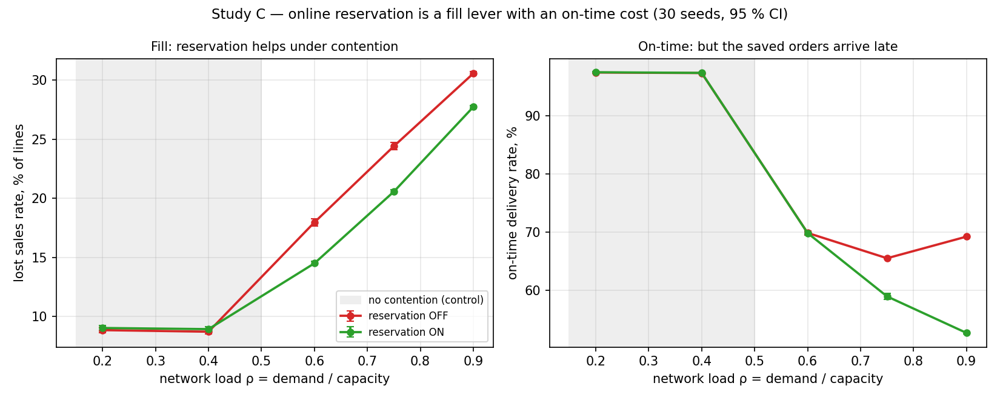
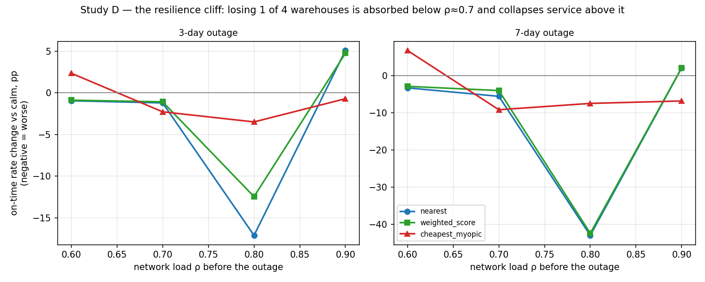
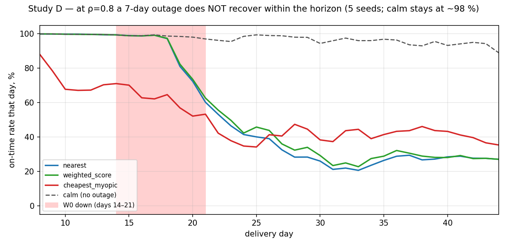

# Ещё два вопроса к сети складов: резервирование и выпадение склада

*Воспроизводимый эксперимент на симуляторе osbench. 1380 прогонов, 30 сидов на ячейку,
парные сравнения с общими случайными числами и поправкой Холма. Продолжение
[первой работы](study_ru.md) (вопросы про sourcing и промис).*

---

## Зачем это

Два следующих вопроса из каталога `questions_ru.md`, оба про инвестиции в IT и в
устойчивость:

- **A1.** «Если OMS будет резервировать остаток в момент заказа, а не на сборке —
  сколько заказов мы перестанем отменять и во что это обойдётся?»
- **D3.** «Насколько политика выбора склада устойчива к выпадению склада, и спасёт ли нас
  более умный алгоритм, когда склад ляжет?»

Протокол тот же, что в первой работе: общие случайные числа (один сид — один мир для всех
вариантов), парная разность по сиду, 95 % доверительные интервалы по t и бутстрепу,
поправка Холма внутри семейства сравнений. Горизонт 45 дней, разогрев 7 дней, 30 сидов.

Главный методический урок обеих работ повторяется и здесь: **правильный выбор первичной
метрики важнее статистики.** В обоих исследованиях напрашивающаяся метрика
(`total_cost_per_order`) вводит в заблуждение, и об этом сказано прямо в тексте.

---

# Исследование C. Окупается ли онлайн-резервирование товара

## Вопрос и механика

Резервирование имеет смысл только там, где несколько заказов борются за одни и те же
дефицитные единицы в окне между **решением sourcing** (где читается ATP) и **сборкой**
(где учётный остаток реально списывается).

- **Резерв выключен:** каждый заказ в этом окне видит один и тот же учётный остаток как
  доступный. Обещается больше единиц, чем есть физически; конфликт всплывает на сборке
  отменённой строкой (штраф `penalty_pick`, самый дорогой).
- **Резерв включён:** первые заказы переводят остаток в резерв, ATP следующих уже видит
  ноль, и они либо уходят на другой склад, либо отказываются раньше и дешевле.

Контеншн рождается в сценарии `exp_a1_reservation`: концентрированный каталог (40 SKU,
тяжёлая голова Ципфа), спрос смещён на восток к складу с узкой мощностью. Политика
sourcing зафиксирована (`weighted_score`).

## План эксперимента

Ось контеншена — нагрузка сети ρ = (заказов/день × строк) / мощность, через
`demand.base_orders_per_day`. Лечение — `reservation.enabled`.

| | |
|---|---|
| Нагрузка ρ | 0,2 / 0,4 / 0,6 / 0,75 / 0,9 |
| Резервирование | выкл / вкл |
| Сиды | 30 |
| Прогонов | 300 |
| Первичная метрика | `lost_sales_rate` |

Ячейки ρ ≤ 0,4 — **контрольная группа**: без контеншена резервирование не должно давать
ничего.

## Почему не total_cost_per_order

В этом сценарии полная стоимость заказа на 85 % состоит из закупочной стоимости
проданного товара. Резервирование выполняет *больше* спроса, поэтому механически
**повышает** стоимость на заказ, делая своё дело: 47,9 → 53,6 при ρ = 0,9. Это не плата
за резервирование, а стоимость дополнительно проданного товара. Первичная метрика —
потерянные продажи; стоимость на заказ в выводах не используется (та же ловушка
знаменателя, что в исследовании B первой работы).

## Результат



Резерв «вкл» минус «выкл», парные разности, поправка Холма:

| ρ | Потерянные продажи, разность | Отн., % | Доля вовремя, разность | Отмены на сборке (выкл → вкл) |
|---|---|---|---|---|
| 0,20 | +0,0018 | +2,0 | +0,0005 н/з | 0,0009 → 0 |
| 0,40 | +0,0022 | +2,5 | +0,0003 н/з | 0,0012 → 0 |
| **0,60** | **−0,0347** | **−19,3** | −0,0003 н/з | **0,0294 → 0** |
| **0,75** | **−0,0384** | **−15,7** | **−0,0657** | 0,0034 → 0 |
| **0,90** | **−0,0283** | **−9,3** | **−0,1656** | 0,0003 → 0 |

### Три вывода

**1. Ниже порога контеншена резервирование не делает ничего.**
При ρ ≤ 0,4 разность потерянных продаж +2 % — формально значима при 30 сидах, но это
доли процента в неправильную сторону. Резервирование при недогруженной сети — чистые
затраты на внедрение без отдачи. Это ровно гипотеза из каталога, подтверждённая на
контрольной группе.

**2. Под контеншеном резервирование — это рычаг fill rate.**
При ρ ≥ 0,6 оно снижает потери продаж на 9–19 % и **полностью обнуляет отмены на сборке**
(они и есть тот конфликт, который резервирование устраняет по построению). Пик
относительного эффекта — при ρ = 0,6, где отмены на сборке максимальны (2,9 % строк).

**3. Но это не бесплатно: спасённые заказы приезжают позже.**
При ρ = 0,75 и 0,9 доля доставок вовремя падает на 6,6 и 16,6 п.п. Выглядит как ухудшение
сервиса, но это во многом **survivorship-артефакт**: без резерва трудные заказы
отменялись и вовсе не попадали в знаменатель «вовремя»; с резервом они исполняются — но
поздно — и теперь портят статистику. Подтверждение: хвост опозданий `lateness_days_p90`
при включённом резерве **меньше** (21 → 12 дней при ρ = 0,9). То есть резерв не делает
доставку катастрофически поздней — он просто вытаскивает в статистику заказы, которые
раньше вы молча теряли.

### Управленческий вывод

Резервирование — **не универсальный выигрыш, а размен**: больше выполненных заказов
против чуть более позднего их исполнения, и только при контеншене. Решение зависит от
того, что у вас является ограничением:

- если жмёт **fill rate / потерянные продажи** и сеть работает под контеншеном (ρ ≳ 0,6) —
  резервирование окупается, снимая до пятой части отмен;
- если жмёт **доля вовремя**, а сеть недогружена — резервирование не поможет, а KPI вовремя
  может даже просесть за счёт учёта ранее отменявшихся заказов.

---

# Исследование D. Насколько сеть устойчива к выпадению склада

## Вопрос и механика

Сценарий `exp_d3_outage`: четыре склада по углам со своими регионами плюс оспариваемый
центр, запас обильный (покрытие 30 дней) — исследование про потерю *мощности и доступа*,
а не про дефицит. Выпавший склад маскируется из ATP на время простоя, его заказы уходят
на три выживших — более далёких и вместе держащих лишь ¾ дневной мощности сети.

## План эксперимента

| | |
|---|---|
| Нагрузка ρ до простоя | 0,6 / 0,7 / 0,8 / 0,9 |
| Длительность простоя | 0 / 3 / 7 дней (склад W0, старт на 14-й день) |
| Политики | `nearest`, `weighted_score`, `cheapest_myopic` |
| Сиды | 30 |
| Прогонов | 1080 |
| Первичная метрика | `promise_hit_rate` (деградация к спокойному прогону) |

## Результат 1: обрыв устойчивости



Деградация доли вовремя при 7-дневном простое (парно к спокойному, поправка Холма):

| ρ | `nearest` | `weighted_score` | Что происходит |
|---|---|---|---|
| 0,6 | −3,3 п.п. | −2,9 п.п. | три склада поглощают потерю |
| 0,7 | −5,6 п.п. | −4,0 п.п. | ещё управляемо |
| **0,8** | **−43,0 п.п.** | **−42,4 п.п.** | **обвал сервиса** |
| 0,9 | +2,1 п.п.* | +2,2 п.п.* | база уже обрушена, * survivorship |

Картина — это обрыв, а не плавный склон. Арифметика прямая: потеря 1 склада из 4 убирает
25 % мощности. При ρ = 0,6 нагрузка на выживших поднимается до 0,80 — ещё терпимо. При
ρ = 0,8 она поднимается до 1,07 — за край, и сервис обваливается. Порог — между 0,7 и 0,8.

(При ρ = 0,9 деградация формально положительная: спокойная база уже на 0,29, а простой
добавляет потерянных продаж, которые выбывают из знаменателя «вовремя» — тот же
survivorship-артефакт, что в исследовании C. Это не улучшение.)

## Результат 2: решает не алгоритм, а запас мощности

Самое важное наблюдение: `nearest` и `weighted_score` деградируют **почти одинаково** —
−43,0 против −42,4 п.п. на обрыве. Умный алгоритм выбора склада даёт стабильное, но
мизерное преимущество (при ρ = 0,7 чуть заметнее: −4,0 против −5,6 п.п.). Устойчивость к
выпадению склада определяется **не политикой sourcing, а запасом мощности**, с которым
сеть вошла в шок.

Это прямо дополняет исследование A из первой работы: там алгоритм имел значение лишь в
узкой полосе нагрузки, здесь для устойчивости он не имеет значения вовсе. В обоих случаях
первично физическое ограничение — мощность, — а не сообразительность политики.

## Результат 3: шок при высокой загрузке не восстанавливается



Посуточная доля вовремя при ρ = 0,8 и 7-дневном простое. Спокойный прогон держит ~98 %
весь горизонт. Прогон с простоем начинает проваливаться с 18-го дня (с задержкой: доставка
отстаёт от момента заказа), падает до ~25 % и **не возвращается** за оставшиеся 23 дня до
конца горизонта.

Горизонтальный агрегат `promise_hit_rate` = 0,553 для этой ячейки маскирует не временный
провал, а **устойчивый сдвиг режима**. 7 дней потери одного склада при нагрузке 0,8 — это
не выбоина на неделю, а яма, из которой сеть не выбирается за три недели. Причина: за время
простоя выжившие склады истощили запас быстрее, чем пополнение (цикл 7 дней, срок 5 дней)
успевает восстановить, и образовавшийся бэклог не рассасывается при оставшихся 20 % запаса
мощности.

### Управленческий вывод

1. **Устойчивость покупается запасом мощности, а не алгоритмом.** Если сеть работает при
   загрузке выше ~0,75, потеря одного склада из четырёх опрокидывает сервис независимо от
   того, какой sourcing у вас стоит. Деньги на устойчивость надо класть в резерв мощности,
   а не в алгоритм.
2. **Шок при высокой загрузке — лассирующее событие, а не недельный провал.** Планировать
   надо не «7 дней просадки», а недели восстановления и соответствующий накопленный ущерб.
3. **Знайте свой обрыв.** Для сети с N равными складами потеря одного поднимает нагрузку в
   1/(1−1/N) раз (для N = 4 — в 1,33 раза). Если результат превышает ~1,0, готовьтесь к
   обвалу. Это считается на салфетке до любого моделирования.

---

## Ограничения

1. **Сценарии синтетические и сконструированы под вопрос.** Числа (−19 %, −43 п.п.)
   нельзя переносить на конкретную сеть; переносятся *форма* (порог контеншена для
   резервирования, обрыв устойчивости по ρ) и *механизм* (размен fill/on-time; мощность
   важнее алгоритма).
2. **`total_cost_per_order` в обоих исследованиях вводит в заблуждение** и в выводах не
   используется: в C он на 85 % состоит из закупки проданного товара, в D искажается
   survivorship при коллапсе сервиса. Первичные метрики — `lost_sales_rate` и
   `promise_hit_rate` соответственно.
3. **Точность учёта = 1,0.** Поэтому отмены на сборке без резерва — это чистый эффект
   конфликта заказов, не фантомных остатков. С `inventory_accuracy < 1` эффект
   резервирования был бы иным (и это отдельный вопрос A3 из каталога, пока открытый).
4. **Выпадение всегда бьёт по W0 и стартует на 14-й день.** Устойчивость к выпадению
   *центрального* склада или к одновременной потере двух складов не исследована.
5. **Пополнение одно (`base_stock`), горизонт 45 дней.** Невосстановление в исследовании D
   частично обусловлено инерцией именно `base_stock`; более агрессивное пополнение
   восстанавливалось бы быстрее — это пересечение с вопросом D2 (согласованность
   пополнения и sourcing).
6. **Кривая восстановления — 5 сидов** (ради экономии на хранении журналов событий);
   агрегаты по ячейкам — 30 сидов.

---

## Как воспроизвести

```bash
conda activate rapids-13

python experiments/study_c_reservation.py   # 300 прогонов, ~1,5 мин
python experiments/study_d_outage.py        # 1080 прогонов + кривые, ~5 мин
python experiments/make_figures2.py
```

Результаты — в `experiments/results/`:

| Файл | Содержание |
|---|---|
| `study_c_*`, `study_d_*` (`raw.parquet` / `cells.csv` / `compare.csv`) | исходные метрики, средние, парные разности с ДИ и p после Холма |
| `study_d_recovery.csv` | посуточная доля вовремя (спокойный vs простой) |
| `figures/study_c_*.png`, `study_d_*.png` | графики этой статьи |

Сценарии: `scenarios/exp_a1_reservation.yaml`, `scenarios/exp_d3_outage.yaml`.
Остальные вопросы каталога — в `questions_ru.md`.
