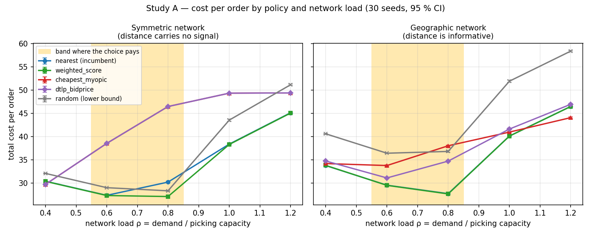
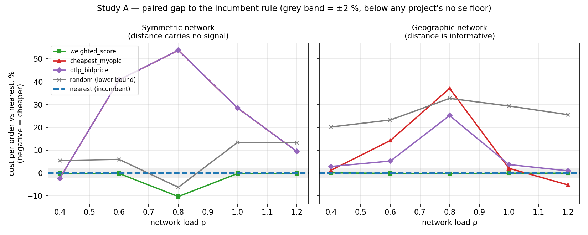
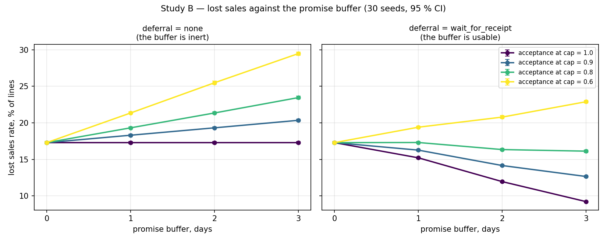
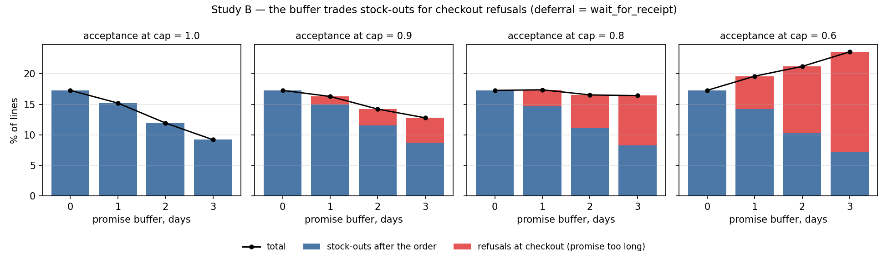

# Two questions about a warehouse network, answered with numbers

*A reproducible experiment on the osbench simulator. 2,460 runs, 30 seeds per cell,
paired comparisons under common random numbers with a Holm correction.*

---

## Why this exists

An e-commerce manager keeps running into questions that the industry usually answers with
common sense or someone else's case study:

- Our OMS ships from the nearest warehouse. Is something smarter worth building?
- If we stop promising tomorrow and start promising the day after, what do we get?

The honest answer to both is "it depends". True, and useless: the budget decision has to
be made anyway. A simulator turns "it depends" into a boundary: *in this band of network
load the project pays for itself and outside it does not; at this level of customer
patience the buffer buys sales, at that level it destroys them*.

Below are two studies run on the osbench testbed. Both follow the same protocol, both
produced a stable result, and both include a control arm that shows the effect is real.

---

## The protocol

The testbed is a discrete-event simulator of a warehouse network: orders, inventory,
replenishment, reservation, the promised date, picking under a daily warehouse capacity,
and zone-based shipping. The sourcing policy is a plugin.

Three things make the results comparable:

**Common random numbers.** One seed is one world: the same warehouses, the same SKUs, the
same order stream minute by minute. Every variant of the experiment sees exactly that
stream. The random streams that are only queried on certain events (customer decisions,
processing times, delivery noise, supplier lead times) are counter-based generators: the
value is derived from the event key, not from a position in a sequence. So a branch taken
in one variant does not shift the random numbers in another.

**Paired comparison.** We do not compare the mean of variant A against the mean of variant
B; we take the difference seed by seed. The between-seed variance — which dominates here —
leaves the denominator entirely.

**Multiplicity control.** A 5-policy × 10-cell grid is 40 comparisons per metric;
uncorrected, a few "significant" findings would show up on their own. A Holm step-down
procedure is applied across the family of comparisons within each metric.

Horizon is 45 days, the first 7 discarded as warm-up. 30 seeds per cell.

---

# Study A. When a sourcing algorithm pays off

## The question

> "We ship from the nearest warehouse. What are we losing, and under what conditions?"

## Scenarios

The main trap in this kind of experiment is to build one scenario in which the desired
answer follows by construction. So there are two, and they differ in exactly one thing:
*whether distance carries useful information*.

| | `exp_a_symmetric` | `exp_a_geographic` |
|---|---|---|
| Warehouses | 3 on an equilateral triangle around the customers | 4 in the corners, each with a local region |
| Distance to customer | near-identical from any warehouse | strongly differentiated |
| Picking capacity | 3 × 200 = **600 lines/day** | 4 × 150 = **600 lines/day** |
| Inventory | 30 days of cover (no scarcity) | 30 days of cover |
| Lateness penalty | 4 units per day | 4 units per day |

Tariffs, catalogue (120 SKUs), supplier, horizon and penalties are identical. Total
capacity is deliberately the same, so that the load axis means the same thing in both.

In the first scenario "ship from the nearest warehouse" is meaningless — every warehouse
is equidistant, and the only meaningful signal is load. In the second, "nearest" is a
strong and correct rule, and balancing load costs real freight. If the conclusion holds in
both, it is not an artefact of geometry.

## Experiment design

- **Load axis** ρ = (orders/day × lines per order) / picking capacity ∈ {0.4, 0.6, 0.8, 1.0, 1.2},
  varied through `demand.base_orders_per_day`.
- **Policies**: `random` (lower bound), `nearest` (the baseline — what most networks
  actually run), `cheapest_myopic` (minimise the immediate shipping cost), `weighted_score`
  (a 7-factor weighted score with default weights), `dtlp_bidprice` (forecast LP, dual
  prices as the opportunity cost of inventory).
- 2 scenarios × 5 loads × 5 policies × 30 seeds = **1,500 runs** (7 minutes on 20 cores).
- Primary metric: `total_cost_per_order`, paired difference against `nearest`.

## Results





Paired difference against `nearest`, cost per order, % (negative = cheaper).
All values Holm-adjusted; "n.s." = not significant at 95 %.

| Scenario | ρ | `weighted_score` | `cheapest_myopic` | `dtlp_bidprice` | `random` |
|---|---|---|---|---|---|
| symmetric | 0.4 | −0.10 n.s. | −2.22 | −2.25 | +5.53 |
| symmetric | 0.6 | −0.15 n.s. | **+40.78** | **+40.80** | +6.01 |
| symmetric | **0.8** | **−10.27** | **+53.74** | **+53.75** | **−6.20** |
| symmetric | 1.0 | −0.20 | +28.51 | +28.51 | +13.44 |
| symmetric | 1.2 | −0.13 | +9.48 | +9.48 | +13.35 |
| geographic | 0.4 | +0.12 n.s. | +1.27 | +2.90 | +20.21 |
| geographic | 0.6 | −0.11 n.s. | **+14.30** | +5.28 | +23.25 |
| geographic | **0.8** | −0.22 | **+37.08** | **+25.21** | +32.71 |
| geographic | 1.0 | −0.04 n.s. | +2.11 | +3.74 | +29.38 |
| geographic | 1.2 | −0.03 | −5.18 | +0.99 | +25.57 |

### Three findings

**1. "Nearest warehouse" is a surprisingly strong baseline.**
`weighted_score` with default weights beats it in exactly one cell out of ten — the
symmetric network at ρ = 0.8, where it wins **10.3 %** (95 % CI: 9.6 % to 10.9 %;
p < 10⁻⁶ after Holm). In the other nine cells the difference never exceeds 0.25 % in
absolute value. Some of those differences are statistically significant — with 30 seeds
and CRN, fractions of a percent are detectable — but none is economically meaningful.
That distinction matters: **significance here is not the same as significance to the
business.**

**2. Naively optimising shipping cost is not an improvement, it is an accident.**
`cheapest_myopic` does precisely what its name says, and does it well: it has the lowest
shipping cost per order in every cell (5.02 against 5.97 for `nearest` in the symmetric
network at ρ = 0.8, i.e. 16 % cheaper). And it is **53.7 %** more expensive than the
baseline on total cost. The decomposition explains why:

| symmetric, ρ = 0.8 | `nearest` | `cheapest_myopic` |
|---|---|---|
| Shipping cost per order | 5.97 | **5.02** |
| On-time rate | 0.700 | **0.197** |
| Lateness penalties | 8,035 | **34,686** |
| Lost sales | 6.4 % | **26.5 %** |

The policy breaks the tie in favour of the same warehouse every time, that warehouse hits
its daily capacity, orders queue and ship late. Every unit saved on freight comes back as
four units of penalty. This is a direct warning against a "let's optimise shipping cost"
project that ignores the capacity constraint.

**3. In the blind regime, picking a warehouse at random beats picking the nearest.**
In the symmetric network at ρ = 0.8, `random` is **6.2 %** cheaper than `nearest`. This is
not a curiosity, it is a diagnostic: if randomly spreading load beats a geographic rule,
then in that regime all the value of the decision is in balancing, and distance is
irrelevant. In the geographic scenario, where distance is informative, `random` loses
20–33 % in every regime, exactly as a lower bound should.

### When the project pays off

The picture is the same in both geometries and splits into three regimes:

| Regime | What happens | What to do |
|---|---|---|
| **ρ ≤ 0.5** — network underloaded | there is slack for everyone, any sensible rule works; the spread across policies is fractions of a percent | do not invest in the algorithm |
| **ρ ≈ 0.6–0.85** — network at its limit | the decision is worth the most: up to 10 % saved by a smart policy, up to 54 % lost to a naive one | this, and only this, is where the project makes sense |
| **ρ ≥ 1.0** — network overloaded | there is physically not enough capacity, every policy converges, 22–36 % of lines are lost | you need capacity, not software |

In one sentence: **before discussing a sourcing algorithm, compute the ratio of demand to
picking capacity.** Below 0.5 or above 1.0 the algorithm project will not pay for itself —
in the first case there is nothing to optimise, in the second there is nothing to optimise
with.

---

# Study B. What an extra day on the promised date actually buys

## The question

> "If we stop promising tomorrow and start promising the day after, how much do we save
> and how many customers do we lose?"

## Scenario

`exp_b_scarcity` is a scarcity regime, because a buffer in the promise needs something to
buy:

- one slow supplier: 14-day lead time with a 3-day spread, so receipts are late and jittery;
- 8 days of initial cover, so the network runs into shortages before the first receipts;
- a heavy Zipf head (`zipf_a` = 1.2) — a handful of SKUs carry demand and run out first;
- demand skewed East, where the local warehouse is the capacity-tightest;
- lateness costs money (2 units/day), and breaking a promise after deliberately choosing
  to wait costs double (`penalty_deferral_miss` = 2.0).

The sourcing policy is fixed (`weighted_score`) so that effects do not mix.

## Experiment design

Three crossed axes, 32 cells, 30 seeds — **960 runs** (2 minutes):

| Axis | Levels | Meaning |
|---|---|---|
| `promise.buffer_days` | 0, 1, 2, 3 | how much slack we put into the promised date |
| `deferral.mode` | `none`, `wait_for_receipt` | may an order *use* that slack and wait for an inbound receipt |
| `promise.p_accept_promise` | 1.0 / 0.9 / 0.8 / 0.6 | probability that the customer accepts the longest allowed promise |

Primary metric: `lost_sales_rate`, the share of lines that never happen. That is what the
buffer is supposed to reduce.

**The control arm** is `deferral = none`. There, the buffer changes the promised date but
nothing about how the order is fulfilled. If the economics moved in that arm, the testbed
would have a bug.

## Result 1: the control held, and that is the headline

With `deferral = none` and a date-indifferent customer (acceptance = 1.0), the buffer
changes **nothing**:

| Buffer, days | 0 | 1 | 2 | 3 |
|---|---|---|---|---|
| Lost sales | 17.29 % | 17.29 % | 17.29 % | 17.29 % |
| Cost per order | 59.25 | 59.17 | 59.14 | 59.13 |
| **On-time delivery rate** | **95.3 %** | **98.0 %** | **99.7 %** | **100.0 %** |

Paired difference in lost sales: −0.0000 (95 % CI −0.00001 to +0.00001, p = 1.0 after
Holm). With 30 seeds under CRN that means literally "no effect".

And the on-time rate went from 95.3 % to **100.0 %**.

That is the result: **the most popular KPI in fulfilment can be driven to perfection by
changing one line in the promise configuration, with no improvement to the network
whatsoever.** No customer got their order earlier, no stock-out was closed, no money was
saved. If OTIF is the headline metric in your reporting, you have a "make it 100 %"
button, and sooner or later somebody will press it.

## Result 2: with deferred sourcing the buffer starts working

Turn on `deferral = wait_for_receipt`: an order short of stock may now wait for an inbound
receipt as long as it still makes the promised date. The customer is still indifferent to
the date:

| Buffer, days | 0 | 1 | 2 | 3 |
|---|---|---|---|---|
| Lost sales | 17.29 % | 15.21 % | 11.95 % | **9.21 %** |
| Paired difference | — | −12.0 % | −30.9 % | **−46.7 %** |
| 95 % CI of the difference, pp | — | [−2.15; −2.02] | [−5.43; −5.26] | [−8.20; −7.96] |
| Share of orders deferred | 0 | 2.2 % | 5.6 % | 8.4 % |
| Cost per order | 59.25 | 59.66 | 60.36 | **60.97** |

Three days of buffer **halve lost sales** at a cost of **+2.9 %** in logistics. Every
difference clears the Holm correction with an enormous margin.

The scale of the intervention is worth noting on its own: **8.4 %** of orders have to
wait, and that is enough to remove half the stock-outs. This is not a process overhaul,
it is a narrow setting that touches a minority of orders.

## Result 3: with an impatient customer the sign flips

All of the above holds under one assumption: the customer does not care about the promised
date. Drop it.



Lost sales under `deferral = wait_for_receipt`:

| Acceptance at the longest promise | Buffer 0 | 1 | 2 | 3 | Net over 3 days |
|---|---|---|---|---|---|
| 1.0 (date does not matter) | 17.29 % | 15.21 % | 11.95 % | 9.21 % | **−46.7 %** |
| 0.9 | 17.29 % | 16.26 % | 14.15 % | 12.65 % | **−26.8 %** |
| 0.8 | 17.29 % | 17.31 % | 16.34 % | 16.12 % | **−6.8 %** |
| 0.6 (date matters) | 17.29 % | 19.40 % | 20.79 % | 22.90 % | **+32.4 %** |

At acceptance 0.6 the buffer does not save sales, it destroys them: losses rise from
17.3 % to 22.9 % — and that is *with* deferred sourcing working.

## Why the sign flips



`lost_sales_rate` is the sum of two flows that the buffer pushes in opposite directions:

| Component | What the buffer does |
|---|---|
| Stock-outs after the order | **reduces** — the order waits for the receipt: −2.1 / −3.3 / −2.7 pp for the first, second and third day |
| Refusals at checkout because the promise is too long | **increases** — by exactly 1.35 / 2.72 / 5.41 pp per day at acceptance 0.9 / 0.8 / 0.6 |

Hence the break-even rule: **the buffer pays as long as the refusals it causes per day
cost less than the stock-outs it buys back.** The gain from waiting is about 2.7 pp per
buffer day. The loss from refusals is linear in customer sensitivity. Setting them equal
gives a threshold at acceptance ≈ **0.80**.

## Testing the prediction

The 0.80 threshold was computed from the 1.0 and 0.6 cells. The 0.9 and 0.8 levels were
added to the grid *after* that calculation, as a test.

| Acceptance | Prediction | Observed (3-day buffer) |
|---|---|---|
| 0.9 | gain | −26.8 % in losses, significant |
| **0.8** | **zero** | **−6.8 %; at a 1-day buffer −0.09 %, p = 1.0 — indistinguishable from zero** |
| 0.6 | loss | +32.4 % in losses, significant |

The predicted turning point landed: at acceptance 0.8 the first buffer day produces an
effect statistically indistinguishable from zero, and the whole curve runs flat.

## What a manager should take away

1. **Lengthening the promise without being able to use it is cosmetics.** OTIF goes to
   100 %, the economics do not move by a cent. Without deferred sourcing, a promise buffer
   is not a project, it is a reporting edit.
2. **The "buffer + deferred sourcing" pair genuinely buys sales**: −47 % in losses for
   +2.9 % in logistics, and fewer than one order in ten has to wait.
3. **The decision is not made by logistics but by one marketing parameter.** The
   conversion drop per extra promised day is something any shop can measure on its own
   data in a week of A/B testing. If conversion loses more than ~2.7 pp per day, the
   project is negative regardless of how good the logistics are. **Measure that number
   before writing the specification.**

---

## Limitations

An honest result matters more than an impressive one, so here is everything that bounds
these conclusions.

1. **The scenarios are synthetic and built around the question.** `exp_a_symmetric` is a
   deliberately constructed worst case for geographic rules. The numbers (10.3 %, 53.7 %)
   should not be carried over to a specific network; what carries over is the *shape* —
   three regimes in ρ, and a turning point in customer sensitivity.
2. **Tariffs are notional.** One carrier, price a monotone function of distance by zone.
   Real carrier rate cards are not modelled.
3. **`weighted_score` runs with default weights.** No weight tuning (`osbench tune`) was
   performed, so the smart policy's advantage in Study A is, if anything, understated.
4. **`dtlp_bidprice` matched `cheapest_myopic` to four decimals in the symmetric
   scenario.** The reason: with 30 days of cover the dual prices of inventory are near
   zero, so the LP degenerates to myopic and inherits its failure. Daily warehouse
   capacity is not in that LP. This is not a verdict on the method — it says the method
   must be compared in an inventory-scarce regime, not a capacity-scarce one.
5. **`gap_to_hindsight` in the testbed's reports is computed against a shipping-cost-only
   offline LP** and therefore goes negative when a policy trades freight for penalties.
   That metric is not used in any conclusion above.
6. **In Study B, `total_cost_per_order` is misleading in isolation.** The denominator is
   orders created; a checkout refusal removes the order from the numerator but not the
   denominator. So in the impatient-customer arm, cost per order *falls* as the buffer
   grows — simply because some orders are no longer fulfilled. The primary metric there is
   lost sales, and that is not a matter of taste.
7. **45-day horizon, 7-day warm-up, one replenishment policy** (`base_stock`). Seasonality
   and shocks are switched off.

---

## Reproducing this

```bash
conda activate rapids-13

python experiments/study_a_sourcing_payoff.py   # 1,500 runs, ~7 min on 20 cores
python experiments/study_b_promise_buffer.py    #   960 runs, ~2 min
python experiments/make_figures.py
```

Results land in `experiments/results/`:

| File | Contents |
|---|---|
| `study_*_raw.parquet` | one row per (cell, policy, seed) — raw metrics |
| `study_*_cells.csv` | per-cell means and standard errors |
| `study_*_compare.csv` | paired differences, t-CIs, bootstrap CIs, Holm-adjusted p |
| `figures/*.png` | the figures in this article |

Scenarios: `scenarios/exp_a_symmetric.yaml`, `scenarios/exp_a_geographic.yaml`,
`scenarios/exp_b_scarcity.yaml`. The full catalogue of questions the testbed could take on
next is in `questions_en.md`.
