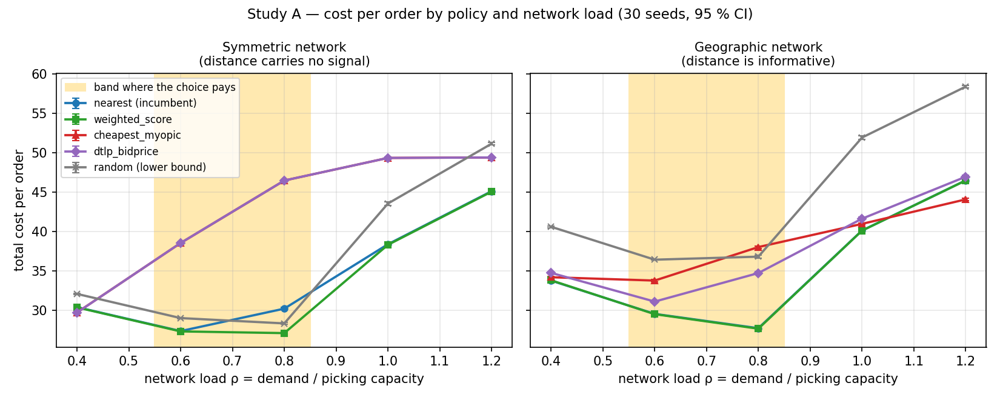
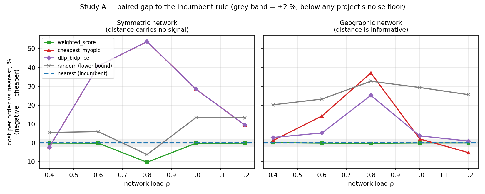
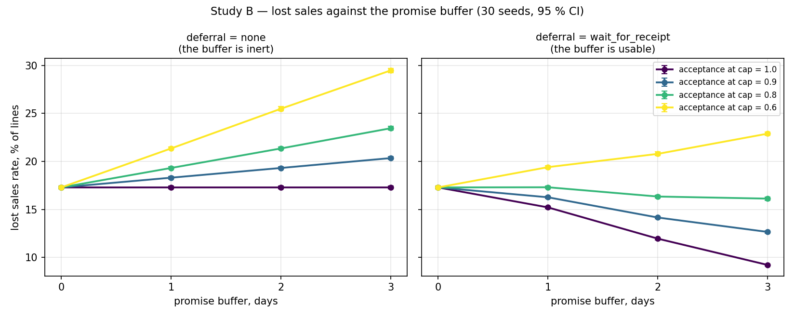
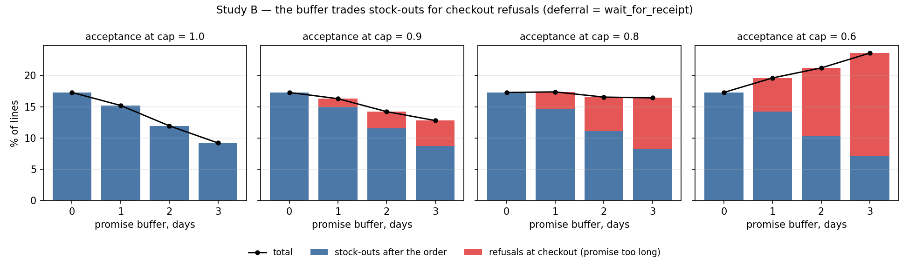

# Два вопроса к сети складов, на которые можно ответить цифрами

*Воспроизводимый эксперимент на симуляторе osbench. 2460 прогонов, 30 сидов на ячейку,
парные сравнения с общими случайными числами и поправкой Холма.*

---

## Зачем это

У менеджера интернет-магазина регулярно возникают вопросы, на которые в отрасли принято
отвечать ссылкой на здравый смысл или на чужой кейс:

- Наш OMS отправляет заказ с ближайшего склада. Стоит ли ставить что-то умнее?
- Если мы начнём обещать клиенту не завтра, а послезавтра — что мы с этого получим?

Ответ на оба вопроса почти всегда звучит как «зависит от ситуации». Это правда, но
бесполезно: решение о бюджете принимать всё равно надо. Симулятор позволяет превратить
«зависит» в конкретную границу: *вот в этом диапазоне загрузки сети проект окупается,
а вот в этом — нет; вот при такой чувствительности клиента к сроку буфер приносит
продажи, а вот при такой — отбирает их*.

Ниже — два исследования, проведённые на стенде osbench. Оба построены по одному
протоколу, оба дали устойчивый результат, и оба содержат контрольную группу, которая
показывает, что эффект не померещился.

---

## Как устроен протокол

Стенд — дискретно-событийный симулятор сети складов: заказы, запасы, пополнение,
резервирование, обещанный срок, сборка с учётом дневной мощности склада, доставка по
зонам. Политика выбора склада — подключаемый плагин.

Три вещи делают результаты сравнимыми:

**Общие случайные числа.** Один сид — один и тот же мир: те же склады, те же SKU, тот же
поток заказов поминутно. Все варианты эксперимента видят ровно этот поток. Случайные
потоки, которые опрашиваются только при определённых событиях (решения клиента, времена
сборки, шум доставки, сроки поставки), реализованы как counter-based генераторы:
значение считается от ключа события, а не от позиции в последовательности. Поэтому
ветвление в одном варианте не сдвигает случайные числа в другом.

**Парное сравнение.** Сравнивается не «среднее варианта A против среднего варианта B»,
а разность по каждому сиду отдельно. Межсидовая дисперсия — а она тут основная —
уходит из знаменателя целиком.

**Поправка на множественность.** В сетке «5 политик × 10 ячеек» 40 сравнений на метрику;
без поправки несколько «значимых» находок появятся сами собой. Применяется процедура
Холма по семейству сравнений внутри метрики.

Горизонт — 45 дней, первые 7 отбрасываются как разогрев. 30 сидов на ячейку.

---

# Исследование A. Когда sourcing-алгоритм окупается

## Вопрос

> «Мы отправляем заказ с ближайшего склада. Что мы теряем и при каких условиях?»

## Сценарии

Главная ловушка таких экспериментов — построить один сценарий, в котором нужный ответ
получается по конструкции. Поэтому сценариев два, и они различаются ровно одним:
*несёт ли расстояние полезную информацию*.

| | `exp_a_symmetric` | `exp_a_geographic` |
|---|---|---|
| Склады | 3 в вершинах равностороннего треугольника вокруг клиентов | 4 по углам, у каждого свой регион |
| Расстояние до клиента | почти одинаковое с любого склада | сильно различается |
| Мощность сборки | 3 × 200 = **600 строк/день** | 4 × 150 = **600 строк/день** |
| Запас | покрытие 30 дней (дефицита нет) | покрытие 30 дней |
| Штраф за опоздание | 4 у.е. за день | 4 у.е. за день |

Тарифы, каталог (120 SKU), поставщик, горизонт и штрафы идентичны. Суммарная мощность
намеренно одинакова, чтобы ось нагрузки означала в обоих сценариях одно и то же.

В первом сценарии правило «ближайший склад» бессмысленно — все склады равноудалены,
и единственный осмысленный сигнал — загрузка. Во втором «ближайший» — сильное и
правильное правило, а балансировка загрузки стоит денег на фрахте. Если вывод совпадёт
в обоих, он не артефакт геометрии.

## План эксперимента

- **Ось нагрузки** ρ = (заказов/день × строк в заказе) / мощность сборки ∈ {0,4; 0,6; 0,8; 1,0; 1,2}.
  Варьируется `demand.base_orders_per_day`.
- **Политики**: `random` (нижняя граница), `nearest` (базовая — то, что стоит у большинства),
  `cheapest_myopic` (минимизировать текущую стоимость доставки), `weighted_score`
  (взвешенная оценка по 7 факторам, веса по умолчанию), `dtlp_bidprice` (LP на прогноз,
  двойственные цены как альтернативная стоимость запаса).
- 2 сценария × 5 нагрузок × 5 политик × 30 сидов = **1500 прогонов** (7 минут на 20 ядрах).
- Первичная метрика — `total_cost_per_order`, парная разность к `nearest`.

## Результат





Парная разность к `nearest`, стоимость на заказ, % (отрицательное — дешевле).
Все значения с поправкой Холма; «н/з» — незначимо на уровне 95 %.

| Сценарий | ρ | `weighted_score` | `cheapest_myopic` | `dtlp_bidprice` | `random` |
|---|---|---|---|---|---|
| symmetric | 0,4 | −0,10 н/з | −2,22 | −2,25 | +5,53 |
| symmetric | 0,6 | −0,15 н/з | **+40,78** | **+40,80** | +6,01 |
| symmetric | **0,8** | **−10,27** | **+53,74** | **+53,75** | **−6,20** |
| symmetric | 1,0 | −0,20 | +28,51 | +28,51 | +13,44 |
| symmetric | 1,2 | −0,13 | +9,48 | +9,48 | +13,35 |
| geographic | 0,4 | +0,12 н/з | +1,27 | +2,90 | +20,21 |
| geographic | 0,6 | −0,11 н/з | **+14,30** | +5,28 | +23,25 |
| geographic | **0,8** | −0,22 | **+37,08** | **+25,21** | +32,71 |
| geographic | 1,0 | −0,04 н/з | +2,11 | +3,74 | +29,38 |
| geographic | 1,2 | −0,03 | −5,18 | +0,99 | +25,57 |

### Три вывода

**1. «Ближайший склад» — на удивление сильная базовая политика.**
`weighted_score` с весами по умолчанию обыгрывает её ровно в одной ячейке из десяти —
в симметричной сети при ρ = 0,8, где выигрыш составляет **10,3 %**
(95 % ДИ: от 9,6 % до 10,9 %; p < 10⁻⁶ после Холма). Во всех остальных девяти ячейках
разность не превышает 0,25 % по модулю. Часть этих разностей статистически значима —
при 30 сидах и CRN различимы и доли процента, — но ни одна не имеет экономического
смысла. Это важное различие: **значимость здесь не равна значимости для бизнеса**.

**2. Наивная оптимизация стоимости доставки — не улучшение, а авария.**
`cheapest_myopic` делает ровно то, что написано в его названии, и делает это хорошо:
у него самая низкая стоимость доставки на заказ во всех ячейках (5,02 против 5,97 у
`nearest` в симметричной сети при ρ = 0,8, то есть на 16 % дешевле). И при этом он
дороже базовой политики на **53,7 %** по полной стоимости. Разложение объясняет почему:

| symmetric, ρ = 0,8 | `nearest` | `cheapest_myopic` |
|---|---|---|
| Стоимость доставки на заказ | 5,97 | **5,02** |
| Доля вовремя | 0,700 | **0,197** |
| Штрафы за опоздание | 8 035 | **34 686** |
| Потерянные продажи | 6,4 % | **26,5 %** |

Политика раз за разом разрывает ничью в пользу одного и того же склада, склад упирается
в дневную мощность, заказы встают в очередь и уезжают с опозданием. Сэкономленный на
фрахте рубль возвращается четырьмя рублями штрафа. Это прямое предупреждение против
проекта «давайте оптимизируем стоимость доставки» без ограничения по мощности.

**3. В «слепом» режиме случайный выбор склада лучше ближайшего.**
В симметричной сети при ρ = 0,8 `random` дешевле `nearest` на **6,2 %**. Это не курьёз,
а диагностика: раз случайное распределение нагрузки обыгрывает географическое правило,
значит, в этом режиме вся ценность решения — в балансировке, и расстояние ни при чём.
В географическом сценарии, где расстояние информативно, `random` проигрывает 20–33 % во
всех режимах, как и положено нижней границе.

### Когда проект окупается

Картина одинакова в обеих геометриях и распадается на три режима:

| Режим | Что происходит | Что делать |
|---|---|---|
| **ρ ≤ 0,5** — сеть недогружена | свободной мощности хватает всем, любое разумное правило работает; разброс между политиками — доли процента | не вкладываться в алгоритм |
| **ρ ≈ 0,6–0,85** — сеть на пределе | цена решения максимальна: до 10 % экономии от умной политики и до 54 % потерь от наивной | здесь и только здесь проект имеет смысл |
| **ρ ≥ 1,0** — сеть перегружена | мощности физически не хватает, все политики сходятся к одному результату, потери 22–36 % строк | нужна мощность, а не софт |

Управленческий вывод формулируется одной фразой: **прежде чем обсуждать алгоритм
sourcing, посчитайте отношение спроса к мощности сборки.** Если оно меньше 0,5 или
больше 1,0, проект по алгоритму не окупится — в первом случае оптимизировать нечего,
во втором нечем.

---

# Исследование B. Что на самом деле даёт лишний день в обещанном сроке

## Вопрос

> «Если перестать обещать завтра и начать обещать послезавтра — сколько мы сэкономим
> и сколько клиентов потеряем?»

## Сценарий

`exp_b_scarcity` — режим дефицита, потому что буферу в сроке нужно что-то выкупать:

- один медленный поставщик: срок 14 дней с разбросом 3 дня, поставки приходят поздно и неровно;
- стартовое покрытие 8 дней, сеть входит в дефицит до первых приходов;
- тяжёлая голова Ципфа (`zipf_a` = 1,2) — несколько SKU тянут спрос и первыми кончаются;
- спрос смещён на восток, где местный склад самый узкий по мощности;
- опоздание стоит денег (2 у.е./день), а срыв обещания после осознанного ожидания —
  вдвое дороже (`penalty_deferral_miss` = 2,0).

Политика sourcing зафиксирована (`weighted_score`), чтобы не смешивать эффекты.

## План эксперимента

Три скрещенные оси, 32 ячейки, 30 сидов — **960 прогонов** (2 минуты):

| Ось | Значения | Смысл |
|---|---|---|
| `promise.buffer_days` | 0, 1, 2, 3 | сколько дней запаса кладём в обещанный срок |
| `deferral.mode` | `none`, `wait_for_receipt` | может ли заказ *воспользоваться* этим запасом и подождать прихода товара |
| `promise.p_accept_promise` | 1,0 / 0,9 / 0,8 / 0,6 | вероятность, что клиент примет самый длинный допустимый срок |

Первичная метрика — `lost_sales_rate`, доля несостоявшихся строк. Именно её буфер и
должен снижать.

**Контрольная группа** — ветка `deferral = none`. Там буфер меняет обещанную дату, но
никак не меняет способ исполнения заказа. Если в этой ветке сдвинется экономика, значит,
в стенде ошибка.

## Результат 1: контроль сработал, и это главный вывод

При `deferral = none` и безразличном к сроку клиенте (acceptance = 1,0) буфер
не меняет **ничего**:

| Буфер, дней | 0 | 1 | 2 | 3 |
|---|---|---|---|---|
| Потерянные продажи | 17,29 % | 17,29 % | 17,29 % | 17,29 % |
| Стоимость на заказ | 59,25 | 59,17 | 59,14 | 59,13 |
| **Доля доставок вовремя** | **95,3 %** | **98,0 %** | **99,7 %** | **100,0 %** |

Парная разность по потерянным продажам: −0,0000 (95 % ДИ от −0,00001 до +0,00001,
p = 1,0 после Холма). При 30 сидах и CRN это означает буквально «эффекта нет».

А показатель «доставлено вовремя» вырос с 95,3 % до **100,0 %**.

Вот это и есть результат: **самый популярный KPI складской логистики поднимается до
идеала изменением одной строки в конфигурации промиса, без единого улучшения в сети.**
Ни один клиент не получил заказ раньше, ни один дефицит не был закрыт, ни один рубль не
сэкономлен. Если OTIF — главная метрика в вашем отчёте, у вас есть кнопка «сделать
100 %», и её рано или поздно кто-нибудь нажмёт.

## Результат 2: с отложенным sourcing буфер начинает работать

Включаем `deferral = wait_for_receipt` — теперь заказ, которому не хватает товара, может
дождаться прихода, если успевает в обещанный срок. Клиент по-прежнему безразличен к сроку:

| Буфер, дней | 0 | 1 | 2 | 3 |
|---|---|---|---|---|
| Потерянные продажи | 17,29 % | 15,21 % | 11,95 % | **9,21 %** |
| Парная разность | — | −12,0 % | −30,9 % | **−46,7 %** |
| 95 % ДИ разности, п.п. | — | [−2,15; −2,02] | [−5,43; −5,26] | [−8,20; −7,96] |
| Доля отложенных заказов | 0 | 2,2 % | 5,6 % | 8,4 % |
| Стоимость на заказ | 59,25 | 59,66 | 60,36 | **60,97** |

Три дня буфера **сокращают потери продаж вдвое** ценой **+2,9 %** логистических затрат.
Все разности значимы после поправки Холма с огромным запасом.

Отдельно стоит отметить масштаб вмешательства: ждать приходится **8,4 %** заказов, и
этого хватает, чтобы убрать половину дефицитов. Это не перестройка процессов, а узкая
настройка для меньшинства заказов.

## Результат 3: при чувствительном клиенте знак переворачивается

Всё предыдущее верно при одном допущении: клиенту безразличен обещанный срок. Снимем его.



Потерянные продажи при `deferral = wait_for_receipt`:

| Acceptance при максимальном сроке | Буфер 0 | 1 | 2 | 3 | Итог за 3 дня |
|---|---|---|---|---|---|
| 1,0 (срок не важен) | 17,29 % | 15,21 % | 11,95 % | 9,21 % | **−46,7 %** |
| 0,9 | 17,29 % | 16,26 % | 14,15 % | 12,65 % | **−26,8 %** |
| 0,8 | 17,29 % | 17,31 % | 16,34 % | 16,12 % | **−6,8 %** |
| 0,6 (срок важен) | 17,29 % | 19,40 % | 20,79 % | 22,90 % | **+32,4 %** |

При acceptance 0,6 буфер не спасает продажи, а уничтожает их: потери растут с 17,3 % до
22,9 %, и это несмотря на то, что отложенный sourcing работает.

## Почему знак переворачивается



`lost_sales_rate` складывается из двух потоков, которые буфер двигает в разные стороны:

| Компонента | Что делает буфер |
|---|---|
| Дефицит после заказа | **снижает** — заказ дожидается прихода: −2,1 / −3,3 / −2,7 п.п. за первый, второй и третий день |
| Отказ на кассе из-за длинного срока | **повышает** — ровно на 1,35 / 2,72 / 5,41 п.п. за день при acceptance 0,9 / 0,8 / 0,6 |

Отсюда правило безубыточности: **буфер окупается, пока отказ на кассе за день буфера
дешевле выкупленного дефицита**. Выигрыш от ожидания — около 2,7 п.п. на день буфера.
Потеря от отказов линейна по чувствительности клиента. Приравниваем и получаем порог:
acceptance ≈ **0,80**.

## Проверка предсказания

Порог 0,80 был посчитан по ячейкам 1,0 и 0,6. Уровни 0,9 и 0,8 были добавлены в сетку
*после* этого расчёта — как проверка.

| Acceptance | Предсказание | Факт (буфер 3 дня) |
|---|---|---|
| 0,9 | выигрыш | −26,8 % потерь, значимо |
| **0,8** | **нуль** | **−6,8 %; при буфере 1 день −0,09 %, p = 1,0 — неразличимо с нулём** |
| 0,6 | проигрыш | +32,4 % потерь, значимо |

Предсказанная точка перелома попала в цель: при acceptance 0,8 первый день буфера даёт
эффект, статистически неотличимый от нуля, и вся кривая идёт горизонтально.

## Управленческий вывод

1. **Удлинять обещанный срок, не умея им воспользоваться, — косметика.** OTIF вырастет
   до 100 %, экономика не изменится ни на копейку. Если в проекте нет отложенного
   sourcing, буфер в сроке — не проект, а правка отчётности.
2. **Связка «буфер + отложенный sourcing» реально выкупает продажи**: −47 % потерь за
   +2,9 % логистики, и ждать нужно меньше одного заказа из десяти.
3. **Решает не логистика, а один маркетинговый параметр.** Падение конверсии на каждый
   лишний день обещанного срока — величина, которую любой магазин может измерить на своих
   данных за неделю A/B-теста. Если конверсия теряет больше ~2,7 п.п. на день, проект
   отрицательный независимо от качества логистики. **Эту цифру надо измерить до того,
   как писать техзадание.**

---

## Ограничения

Честность результата важнее его эффектности, поэтому ниже — всё, что ограничивает выводы.

1. **Сценарии синтетические и сконструированы под вопрос.** `exp_a_symmetric` — это
   худший случай для географических правил, построенный намеренно. Числа (10,3 %, 53,7 %)
   не нужно переносить на конкретную сеть; переносить нужно *форму зависимости* —
   три режима по ρ и точку перелома по чувствительности клиента.
2. **Тарифы условные.** Один перевозчик, цена — монотонная функция расстояния по зонам.
   Реальные сетки операторов не моделируются.
3. **`weighted_score` взят с весами по умолчанию.** Подбор весов (`osbench tune`) не
   проводился, то есть выигрыш умной политики в исследовании A скорее занижен.
4. **`dtlp_bidprice` в симметричном сценарии совпал с `cheapest_myopic` до четвёртого
   знака.** Объяснение: при покрытии 30 дней двойственные цены запаса около нуля, и LP
   вырождается в myopic, унаследовав его провал. Дневная мощность склада в эту LP не
   входит. Это не приговор методу — это указание, что его надо сравнивать в режиме
   дефицита запаса, а не дефицита мощности.
5. **`gap_to_hindsight` в отчётах стенда считается против офлайн-LP только по стоимости
   доставки** и поэтому уходит в минус, когда политика меняет фрахт на штрафы. В выводах
   выше эта метрика не используется.
6. **В исследовании B `total_cost_per_order` вводит в заблуждение, если смотреть отдельно.**
   Знаменатель — созданные заказы, а отказ на кассе убирает заказ из числителя, но не из
   знаменателя. Поэтому в ветке с чувствительным клиентом стоимость на заказ *падает*
   при росте буфера — просто потому, что часть заказов перестали исполнять. Первичная
   метрика там — потерянные продажи, и это не вопрос вкуса.
7. **Горизонт 45 дней, разогрев 7 дней, один режим пополнения** (`base_stock`).
   Сезонность и шоки выключены.

---

## Как воспроизвести

```bash
conda activate rapids-13

python experiments/study_a_sourcing_payoff.py   # 1500 прогонов, ~7 мин на 20 ядрах
python experiments/study_b_promise_buffer.py    #  960 прогонов, ~2 мин
python experiments/make_figures.py
```

Результаты пишутся в `experiments/results/`:

| Файл | Содержание |
|---|---|
| `study_*_raw.parquet` | строка на (ячейка, политика, сид) — исходные метрики |
| `study_*_cells.csv` | средние и стандартные ошибки по ячейкам |
| `study_*_compare.csv` | парные разности, t-ДИ, бутстреп-ДИ, p после Холма |
| `figures/*.png` | графики этой статьи |

Сценарии: `scenarios/exp_a_symmetric.yaml`, `scenarios/exp_a_geographic.yaml`,
`scenarios/exp_b_scarcity.yaml`. Полный каталог вопросов, которые стенд может взять
следующими, — в `questions_ru.md`.
